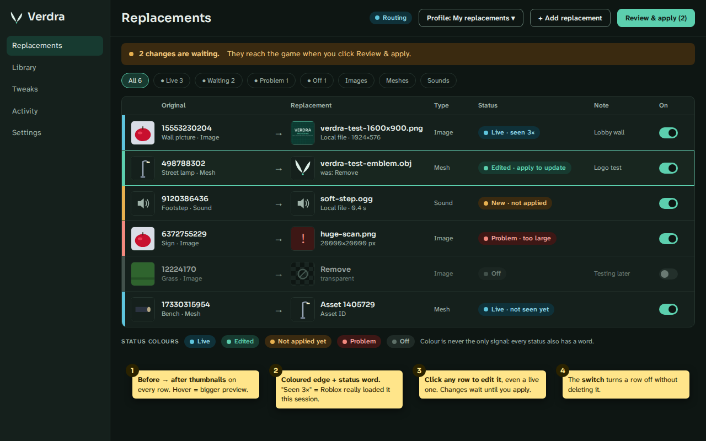
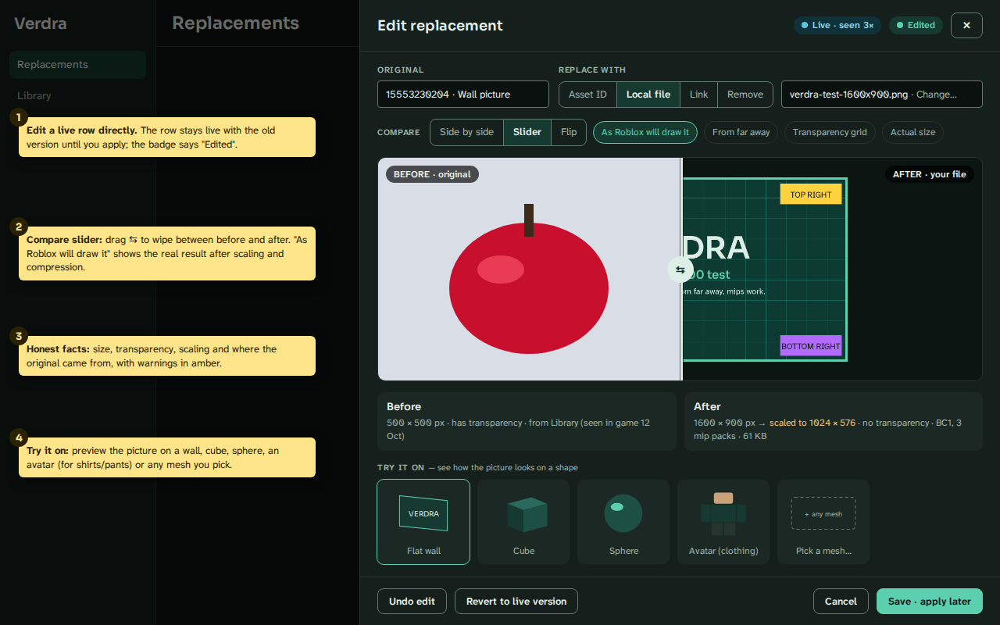
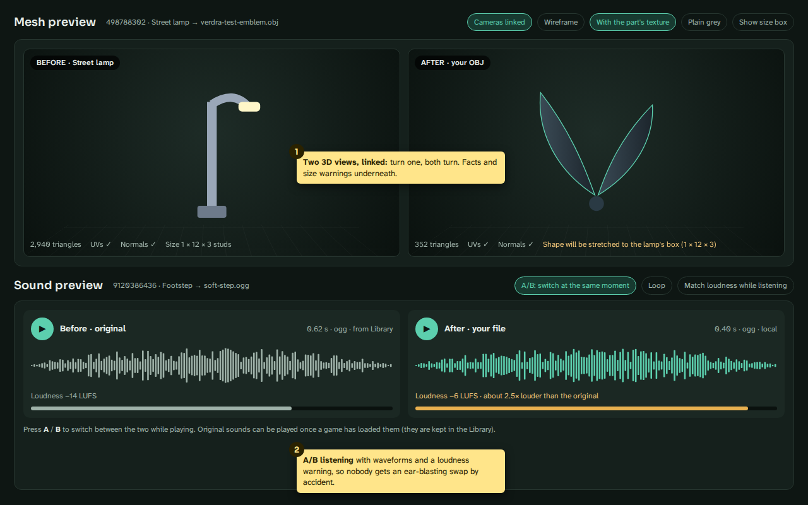
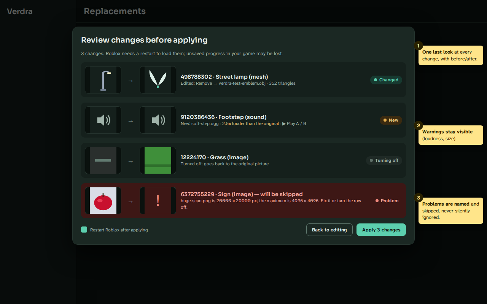
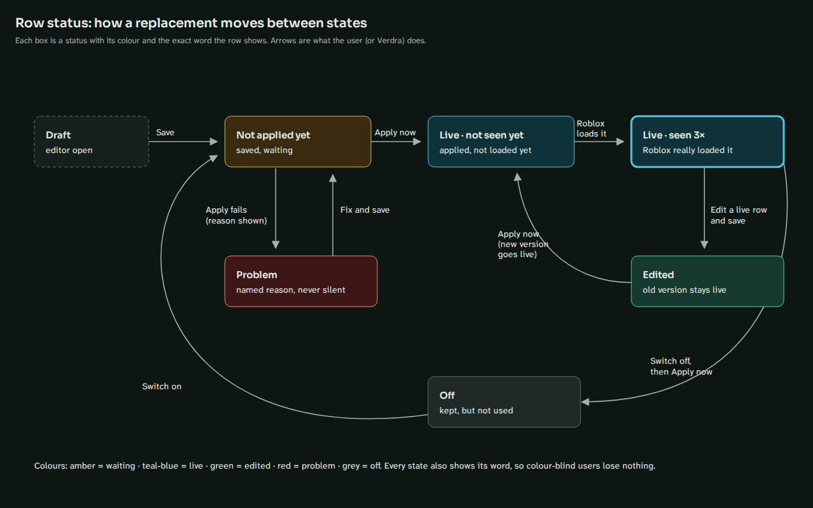

# Editor 2.0: previews, live editing and row status

The owner's design of 13 October 2026 (plan 16.2), copied here in full so it never depends on the
plan tab "Editor 2.0 (previews)". Sections A to L are the owner's text, with US spelling. Section M is the review of
this design against today's code and decisions, and section N the open questions; the owner
answers N before any phase A code (plan rule: no feature outside the specs before 1.0).

The phase A specs are [S-25 Row status](../specs/S-25-row-status.md),
[S-26 Editing replacements in place](../specs/S-26-editing-in-place.md) and
[S-27 Review and apply](../specs/S-27-review-and-apply.md). Phases B and C get their own specs
when they start (phase B with the M3 Library).

## Sketches

Design intent, not final pixels; the yellow numbered notes explain each idea. Dark theme, drawn
with the design-system tokens.

1. [Replacements list with status colors](editor-2/sketch-1-replacements-list-status-colours.png)
   (sections B, C, L): before → after thumbnails, colored edge and status word, "Seen 3×",
   the per-row switch, filter chips, the waiting banner, "Review & apply (2)".
   
2. [Editor with picture compare](editor-2/sketch-2-editor-picture-compare.png) (sections C, F,
   phase B): editing a live row ("Edited" badge), compare slider, "As Roblox will draw it",
   honest facts with amber warnings, Try it on, "Revert to live version", "Save · apply later".
   
3. [Mesh and sound previews](editor-2/sketch-3-mesh-and-sound-preview.png) (section F, phase B):
   two linked 3D views with facts and a stretch warning; A/B sound players with waveforms and a
   loudness warning.
   
4. [Review and apply](editor-2/sketch-4-review-and-apply.png) (section E, phase A): one line per
   change with before → after, warnings visible, problems named and skipped, "Restart Roblox
   after applying", "Apply 3 changes".
   
5. [Row state diagram](editor-2/sketch-5-row-state-diagram.png) (section B): the seven states and
   the transitions between them.
   

## A. Goals and principles

1. See before you apply: every row shows original and replacement side by side.
2. Show what Roblox will really get: previews show the result after Verdra's conversion (scaled
   size, compression, mip levels, stretched mesh box), not just the raw file.
3. Edit, never rebuild: a live row can be changed in place; the old version stays live until the
   user applies.
4. Always know what's live: one clear status per row, with color AND word. "Seen in game" only
   when Roblox really loaded it this session.
5. Honest about limits: if Verdra can't show an original, say why and what to do. Never show a
   wrong picture.
6. Same safety rules: no sign-in, no cookies, no security endpoints, no upload of user files,
   decoding within the size limits.
7. Accessible: color never the only signal; full keyboard use; reduced motion respected; light
   and dark themes from the design-system tokens.

## B. Row states (sketches 1 and 5)

Seven states, each shown three ways: a colored left edge, a pill with a word, and a detail where
useful.

| State | Color token | Word on the row | Meaning | How Verdra knows |
| --- | --- | --- | --- | --- |
| Draft | dashed outline, neutral | Draft | editor open, not saved | editor state |
| Not applied yet | warning (amber) | New · not applied | saved, waiting for Apply now | saved differs from applied |
| Edited | primary (green) | Edited · apply to update | live row changed; old version still live | saved version differs from applied version |
| Live · not seen yet | success (teal-blue) | Live · not seen yet | applied; Roblox hasn't asked since it started | applied, no served event yet |
| Live · seen | success, thicker edge | Live · seen 3× | Roblox really loaded the replacement this session | count of "Served the replacement" / batch-rewrite events per row |
| Problem | danger (red) | Problem · short reason | couldn't be prepared or applied; reason named | prepare/apply result per row (logged since #121) |
| Off | ink-disabled (grey), row dimmed | Off | kept in the profile, not used | per-row switch |

Transitions: Draft →(Save) Not applied yet →(Apply now) Live·not seen →(Roblox loads it)
Live·seen. Live →(edit and save) Edited →(Apply now) Live·not seen with the new version. Not
applied →(apply fails) Problem →(fix and save) Not applied. Live →(switch off, then Apply now)
Off →(switch on) Not applied yet.

Rules:

- "Live" uses the success token, not primary, because primary is the button color.
- A banner above the table counts waiting changes ("2 changes are waiting. They reach the game
  when you click Review & apply."), and the button shows the count: "Review & apply (2)".
- Filter chips with counts: All, Live, Waiting, Problem, Off, and by type (Images, Meshes,
  Sounds, …).
- The routing pill (Routing/Degraded/Idle) stays separate from row states.
- Hovering a pill explains it in one sentence; for "seen" it also shows the last load time.
- The "seen" counter is in memory only and lives in the grafter's existing events; no disk or
  network work in the proxy hook (rule S-11).

## C. Editing live rows

- Clicking any row (live or not) opens the editor drawer with every field filled in.
- Each row stores two versions: applied (what the game gets now) and saved (what the user last
  saved). Apply now promotes saved → applied.
- Everything is editable: original ID, kind (Asset ID / Local file / Link / Remove), file or
  link, note, texture slot. Changing a live row's original ID shows in the review as "stops
  replacing A, starts replacing B".
- An on/off switch per row; Off keeps the row.
- "Revert to live version" throws away saved-but-not-applied edits.
- Undo/Redo (already built) covers every edit, switch and delete.
- Row menu: Duplicate (to try a variant), Move to profile…
- Bulk actions on a multi-selection: switch on/off, delete, move to profile, apply only these.
- Inline quick edits: the switch, the note (double-click), dropping a file onto a row's
  replacement cell.
- If the file behind a live row disappears or changes, the row turns Problem with the reason;
  the already-converted applied version keeps working until the next Apply.
- Keyboard: Enter = editor, Space = switch, Ctrl+Z / Ctrl+Y, Delete with confirmation,
  Ctrl+Enter = Review & apply.

## D. Phases (0.1.0 internal comes first, unchanged)

| Phase | Version label | Contents | Depends on |
| --- | --- | --- | --- |
| A: Status and editing | 0.1.x | seven states, seen counter, live editing, switch, revert, duplicate, bulk actions, filters, waiting banner, Review & apply dialog with picture thumbnails | nothing new; no new libraries |
| B: Real previews | 0.2 with M3 Library | picture compare slider, "as Roblox will draw it", "from far away", public thumbnails as fallback, mesh 3D views, sound A/B with waveform and loudness warning, hover popovers | Library cache of originals; OpenGL view; Qt Multimedia |
| C: In context | 0.3+ | Try it on (wall, cube, sphere, blocky avatar for clothing, any mesh), texture on a mesh, skybox viewer, particle preview, material sphere, accessory on mannequin | the phase B renderer |
| With new swap types | later | animation mannequins, model tree; research items: fonts, video | animation and model swaps |

The plan rule "no feature outside the specs before 1.0" applies: each phase starts with specs for
owner approval.

## E. Review and apply dialog (sketch 4, phase A)

- One line per change with before → after: new, changed (old → new target), turning off,
  deleted, and problem rows.
- Warnings stay visible (loudness, size, stretching). In phase B, sounds can be played A/B in the
  list.
- Problem rows are listed as "will be skipped" with the reason and a "Fix" link that opens the
  row.
- A "Restart Roblox after applying" checkbox, on by default when Roblox runs.
- "Apply only selected".
- After applying: a toast "3 changes applied. Roblox is restarting." with an Undo that restores
  the previous applied set.
- Apply never changes anything not shown in this list.

## F. Previews by type (sketches 2 and 3; phases B/C; record now, build later)

Pictures:

- compare modes: side by side, wipe slider (drag ⇆), flip (click or hold Space);
- "As Roblox will draw it": decode Verdra's own converted KTX2 (scaled size, BC1/BC3);
- "From far away": shows mip packs 0/1;
- transparency grid; actual size 1:1;
- facts: pixel size before/after, scaling, transparency, compression, file size, source of the
  original, with amber warnings ("scaled to 1024 × 576", "original had transparency, yours
  doesn't");
- Try it on: wall, cube, sphere, blocky avatar front and back for shirt/pants templates, any mesh
  from the Library or by ID. Old and new.

Meshes:

- two 3D views with linked cameras (orbit, zoom, reset);
- options: with the part's texture, plain grey, wireframe, size box;
- facts: triangles, vertices, UVs/normals, bounding box; a warning when the shape will be
  stretched a lot (Roblox scales meshes to the part's size);
- Remove shows an empty stage, "Nothing is drawn".

Sounds:

- two players with waveforms, duration and format;
- A/B switch at the same playback position (keys A/B), loop, "match loudness while listening";
- a loudness warning when the replacement is much louder (proposal: above +6 dB, e.g. "about
  2.5× louder"); later an optional "make it as loud as the original";
- Remove shows a flat line, "Silence".

Animations (with animation swaps): two R6/R15 mannequins playing in sync, speed, scrubber; facts
(duration, looping, rig, priority); a warning on rig mismatch.

Every row also gets small before → after thumbnails, with a bigger popover on hover.

## G. Other swappable types and their previews (record; feasibility in brackets)

- Decal/Image: compare, Try it on (works today).
- Texture on a mesh: picture compare plus the mesh rendered with old and new texture (when the
  user picks the mesh or the Library saw both).
- Classic Shirt/Pants/T-shirt: blocky avatar front and back (template layout is public; a
  template checker warns if not 585×559 or the layout looks wrong).
- Classic face: head close-up.
- Skybox: 6 faces as a cube cross plus a turnable 360° view (needs grouping 6 IDs into one "sky"
  row; skybox builder from 6 pictures or a panorama).
- Particle texture: small animated emitter.
- UI image/icon/cursor: real size on dark and light backgrounds.
- Material maps (TexturePack slots): a lit sphere (PBR, medium effort).
- Mesh / accessory mesh: 3D views / on a mannequin head.
- Sound: A/B.
- Animation (.rbxm KeyframeSequence/curve, R6↔R15 conversion planned): mannequins.
- Model (.rbxm): parts tree plus 3D view.
- Fonts and Video: research only (how Roblox loads them, sizes, policy).
- Not swappable by design: scripts and game logic, anything server-checked, anything not
  downloaded as an asset.
- "Which items use this texture" automatically: Roblox doesn't say which mesh uses which
  texture; guessing from what loads together is unreliable. Use "Try it on" with a user-picked
  mesh; automatic matching is research only.

## H. Where the original comes from (phase B), in this order, always labeled with its source

1. Library (local): content Roblox already downloaded through Verdra while the user played.
   Exact; works for pictures, meshes, sounds. The M3 Library keeps a small local copy.
2. Public thumbnail service (no sign-in), labeled "thumbnail"; via the existing HTTP client
   (bark/pollinator), same rules as the type check. Cached, no retry loops, graceful when
   rate-limited.
3. Nothing yet: "Join a game that uses this asset once, and Verdra will show it here." This is
   the normal case for sounds until the Library has heard them.

Preview safety:

- user files never leave the PC;
- all decoding within the size limits and off the UI thread; a broken file shows "Can't preview
  this file" plus the reason and never freezes the app (budget: UI never blocked more than
  100 ms);
- cache in `%LOCALAPPDATA%\Verdra\Previews` with a size cap and oldest-first cleanup, its size
  shown in Settings with a "Clear previews" button, removed by Reset everything;
- previews of other people's content are for the user's own screen only; nothing exported or
  shared.

## I. Technical approach and licenses (phase B/C; check each in a decision record)

- Pictures: Qt Widgets painting (QImage, QPainter). LGPL, already used.
- "As Roblox will draw it": decode our KTX2 output with texture2ddecoder (already in the
  project).
- 3D: a small renderer on QOpenGLWidget (Qt OpenGL, LGPL), with a software fallback that renders
  a still picture when OpenGL is weak or missing. Qt Quick 3D is GPL-only in the open-source
  edition: must NOT be used. Check every Qt module's license before use.
- Audio: Qt Multimedia (LGPL); verify that the bundled FFmpeg build is the LGPL build. Waveform
  via QAudioDecoder or a permissive decoder; loudness per EBU R128 / LUFS.
- Row model: saved version, applied version, last apply result, served count this session.

## J. Acceptance tests

Phase A:

1. Editing a live row and saving shows "Edited"; the game keeps the old version until Apply now;
   after Apply the new version is served (log evidence).
2. Switching off and applying makes the game load the original; switching on gives "Not applied
   yet".
3. "Live · seen N×" equals the number of served/batch-rewrite log lines for that asset in the
   session.
4. Every state is distinguishable without color; a screen reader reads the state.
5. The review dialog lists every pending change and nothing else; Apply applies exactly that
   list; Undo after apply restores the previous applied set.

Phase B:

6. "As Roblox will draw it" is pixel-identical to decoding the bytes Verdra serves (compare with
   the format-check output).
7. A broken or oversized file shows a named reason and never blocks the UI for more than 100 ms.
8. Previews work offline (Library and local files) and say clearly when an original isn't
   available.
9. Mesh views show the right triangle count and bounding box; cameras stay linked.
10. Sound A/B switches at the same position; the loudness warning appears at the threshold.
11. The preview cache respects its cap and is emptied by Reset everything.

Phase C:

12. Shirt/pants appear on the avatar the right way round (test with a labeled template).
13. Skybox faces land in the right places (labeled faces).

## K. Risks and open questions (recommendations in section N)

- automatic texture→item matching (research only);
- original sounds unavailable until the Library has them;
- thumbnail service limits or changes;
- OpenGL on older PCs (software fallback);
- licenses (Qt Quick 3D GPL, FFmpeg GPL builds);
- scope creep before 1.0 (phases with approved specs);
- the loudness threshold (+6 dB to start; a setting later).

## L. Idea backlog (recorded, unscheduled)

- before → after thumbnails with a hover popover;
- drag a file from Explorer onto a row;
- paste an image from the clipboard as a replacement (saved into Verdra's folder);
- "seen" counter and last-loaded time;
- Activity entries link to their row;
- a search box (ID, file name, note);
- group rows by game (the place they were seen in) and by type; row tags with filters;
- compare two candidate replacements A vs B before choosing;
- "Test mode": apply one row for the next Roblox start only, then switch back;
- loudness fix;
- auto-crop or pad pictures to the original's aspect ratio, with a preview;
- non-destructive tint and brightness for pictures;
- mesh scale, rotate and pivot correction;
- show the original texture on the new mesh with the UV layout drawn on top;
- shirt/pants template checker;
- skybox builder;
- in-game before/after capture for sharing (later, only if possible without touching the game);
- profile contact sheet of all rows (for packs, M7);
- pack previews in the catalogue (M7);
- texture→item auto-matching (research).

## M. Review against today's code and decisions (13 October 2026)

Checked against `main` at 6270633 (after pull requests 128 to 131).

### Facts the phase A design builds on

- **Rows already have a switch and a note.** `Replacement` in `trunk/branches/grafts.py` has
  `enabled` and `note` (S-20), and `ProfileStore.edit_replacement` exists; the table doesn't
  use either yet, and there is no row editor: a row is removed and added again.
- **Undo and redo** keep the whole profile list per edit (`_State`, last 50 edits). They cover
  saved versions only; "Undo after apply" (E) is a separate, one-step undo of the applied set.
- **Saved is applied today, three times over.** Every edit is saved at once; Apply now publishes
  whatever is saved (`Grafts.publish`); startup publishes what is saved
  (`trunk/sapwood/startup.py`), so a saved row reaches the game at Verdra's next start without
  Apply; and when a link finishes downloading, the whole saved set is published again
  (`Grafts._downloaded`). Phase A needs the applied version stored on disk and these three paths
  changed to publish the applied set only (S-26 rules 1 to 3).
- **Converted content lives in memory only.** A local file is read and converted each time the
  snapshot is compiled. "The applied version keeps working until the next Apply" (C) needs a copy
  of the applied source bytes (S-26 rule 4), because the user's file can change or disappear.
- **The grafter's events.** An Asset ID swap is seen only as a rewritten batch item; a file,
  link or Remove as a batch item Verdra answers plus one content download, logged as "Served the
  replacement for asset … (…)". A picture is three mip packs, each its own batch item and
  download, seconds apart (12 October log: 17:46:25, 17:46:39, 17:46:53). So "one load" of a
  picture is up to three events (question N2).
- **Prepare problems are per row already**: `Grafts.warnings` (replacement ID → reason) and
  M-GRAFT-13 in Activity since pull request 121.
- **Tokens exist** for every state: `success` (cyan, "deliberately cyan rather than green"),
  `primary`, `warning`, `danger`, `ink-disabled`, each with `-tint` and `-ink` where needed.

### Corrections to the sketches

- Sketch 4's problem row says "the maximum is 4096 × 4096". The limit is 16,384 pixels a side and
  64 megapixels (plan 10.7, decision record 0024); a 20,000 × 20,000 picture is refused by both
  numbers, so the line reads "huge-scan.png is 20000 × 20000 px; the largest side Verdra accepts
  is 16,384 px." The specs use the decision record's numbers.
- Sketch 3's loudness example: −14 → −6 LUFS is +8 dB. "About 2.5×" is the amplitude ratio
  (10^(8/20) ≈ 2.5); perceived loudness roughly doubles every 10 dB, so it sounds about 1.7× as
  loud. Phase B words it in dB ("8 dB louder than the original") or says "much louder"
  (question N9).
- Sketch 1 shows a sound from a Local file as "New · not applied". Sounds from a file or link
  aren't built (M-SOON-01); until they are, such a row shows Problem with M-SOON-01's reason.

### Every place phase A changes

| Area | File | Change |
| --- | --- | --- |
| Profile format | `trunk/branches/grafts.py` (`Replacement`, `Profile`, `encode`/`decode`), `docs/schemas/verdra.profile.schema.json`, `docs/schemas/` | `verdra.profile` v2: an `applied` version per row and per profile, `original_name`, a reserved `view` object; migration from v1 (S-26) |
| Applied copies | new `trunk/branches/grafts.py` helpers, `soil/terrain.py` (folder name) | content-addressed copies of applied source bytes in `%LOCALAPPDATA%\Verdra\Applied`, removed when no applied version names them |
| Snapshot | `ProfileStore.compile`, `Grafts.publish`, `Grafts._downloaded`, `trunk/sapwood/startup.py` | compile from applied versions (startup, after a download) or from saved versions plus a selection (Review & apply) |
| Store edits | `ProfileStore` | `edit_replacement` used by the editor; `revert`, `duplicate_replacement`, `move_replacements`, bulk switch and delete; deletes of applied rows kept as pending until applied |
| Status | new `trunk/branches/grafts.py` `row_status()` | the seven states (and the pending delete) from saved, applied, warnings, file checks and the seen count |
| Seen counter | `roots/symbionts/grafter.py`, `roots/rules.py` | an `on_served(original, pack)` callback per replaced batch item, like `on_unreadable`; in memory, no disk or network; one log line per replaced item |
| Seen wiring | `trunk/sapwood/startup.py` or `trunk/branches/grafts.py` | the callback crosses to the Qt thread (queued signal); counts reset when Roblox is started through Verdra |
| File checks | `trunk/branches/grafts.py` | size and modified time of applied files, checked when the window is activated and before review; SHA-256 only when they changed |
| Table | `canopy/screens/grafts/screen.py` | status column with pill, colored edge, switch, filters with counts, waiting banner, multi-selection, row menu, inline note, drop on a row, keyboard (Enter, Space, Delete, Ctrl+Y) |
| Editor | `canopy/screens/grafts/editor.py` | opens filled in for any row; "Revert to live version"; "Save · apply later"; title "Edit replacement" |
| Review | new `canopy/screens/grafts/review.py`, `trunk/branches/grafts.py` (`pending_changes()`) | the dialog of S-27; Apply only selected; thumbnails of picture files and links |
| Header | `canopy/crown/header.py` | "Review & apply (n)" replaces "Apply now"; Ctrl+Enter opens the review |
| Apply flow | `canopy/crown/window.py` (`apply_now`, `_restart_roblox`) | runs after the review's confirm; the restart question moves into the dialog's checkbox; S-24's rules (cache move, waiting for links, 10 s cooldown) stay; Undo of the applied set |
| Preview changes | `canopy/screens/grafts/preview.py`, S-23 | stays (conflicts by original); computed from the applied snapshot or, inside the review, from the snapshot the review would publish |
| Activity | `trunk/branches/grafts.py`, S-03 | one line per applied change set ("Applied 3 changes: …"); unchanged otherwise (linking Activity to rows is backlog) |
| Settings | `trunk/almanac/schema.py` (S-02) | `replacements.applied_order` next to `profile_order` |
| Messages | `assets/i18n/verdra_en.ts` | M-ROW-01 to M-ROW-15, M-EDIT-14 to M-EDIT-24, M-REVIEW-01 to M-REVIEW-12; M-APPLY-07 reworded ("Verdra is still restarting Roblox…") |
| Specs | S-20, S-22, S-23, S-24 | refinements pointing to S-25 to S-27; S-24's button becomes Review & apply |
| Docs | `docs/guides/replacements.md`, `PRIVACY.md` (the Applied folder), README | after phase A is built |

No new dependency and no new network call: the asset name shown on a row comes from the same
public asset-details answer the type check already reads (S-22).

## N. Open questions, recommendations and the owner's decisions

**Decided by the owner on 14 October 2026:** every recommendation below is approved as written,
except N2. S-25 to S-27 are Agreed with these decisions in them.

| Question | Decision |
| --- | --- |
| N1 Deleting a live row | Approved: struck through, "Deleted · apply to remove", live until applied |
| N2 What "seen" counts | **Changed: loads, not packs.** A picture load is its pack 0 (or the first pack asked for when pack 0 wasn't); a mesh, a sound or an ID swap counts each replaced request; each pack writes its own DEBUG line saying "load" or "further pack"; the hover says "Roblox loaded it 3 times since it started (last at 21:14; a picture arrives in up to 3 parts)". Refined in S-25 (ID swaps of pictures follow the pack rule; no time window) |
| N3 Changed file | Approved: Edited with "the file changed"; a missing file is Problem; the applied copy keeps working |
| N4 Losing row | Approved: Live · not seen yet with "Another replacement for this asset wins (profile X)" |
| N5 Profile switches, order, moves | Approved: they wait for Review & apply and are listed in it |
| N6 Undo after apply | Approved: one step; restarts again if the apply restarted Roblox |
| N7 Duplicate | Approved: starts Off, right below, note "Copy of <note>" |
| N8 Asset names | Approved, after a source run shows Roblox's real answer carries the name; otherwise ID and type only, said plainly |
| N9 Loudness words (phase B) | Approved: "8 dB louder than the original"; warning "Much louder than the original" from +6 dB |
| N10 Phase A thumbnails | Approved: after-thumbnails for picture files and links, the type icon otherwise |
| N11 Risks | Approved as written; the wheel's FFmpeg license is checked in its files, not assumed |
| N12 Applied copies | Approved: at most 2 GB in total, shown in Settings › System changes, refused in the review with a plain reason |

The original questions and recommendations follow.

1. **Deleting a live row.** It must stay live until applied (E lists "deleted"). Recommendation:
   keep it in the table, struck through, with the Edited color and the word "Deleted · apply to
   remove"; it counts as waiting; Undo or "Revert to live version" brings it back. (An eighth
   look, not an eighth state.)
2. **What "seen N×" counts.** A picture arrives as up to three packs, each a separate request.
   Recommendation: count each replaced batch item (one log line each, so J3 holds exactly), and
   say so on hover: "Roblox asked for it 3 times since it started (a picture comes in up to 3
   parts)." Alternative: count only full-detail requests, which reads closer to "loaded once"
   but hides far-away loads.
3. **A live row whose file changed.** C says it turns Problem. Recommendation: a missing file is
   Problem ("file missing"); a changed file is Edited with the detail "the file changed", since
   applying it is a normal update, not a fault. The applied copy keeps working either way.
4. **Rows another row overrides.** A live row can lose a conflict (S-20 rule 1) and is then never
   served. Recommendation: keep its state Live · not seen yet and add the detail "Another
   replacement for this asset wins (profile X)". No new state.
5. **Profile switches and order.** They change what the game gets too, so "Apply never changes
   anything not shown" needs them in the review. Recommendation: store an applied switch per
   profile and the applied order; the review lists "Profile X turning off: 12 replacements go
   back to the originals" and "Asset 123 now comes from profile Y".
6. **Undo after apply.** Recommendation: Undo publishes the previous applied set and, if this
   apply restarted Roblox, restarts it again (after the 10 s cooldown); saved versions are
   untouched, so the undone rows show Edited or New again. One step only.
7. **Duplicate.** A copy of a row names the same original, which is a conflict. Recommendation:
   the copy starts switched Off, right below the row, with note "Copy of <note>".
8. **Asset names on rows** ("Wall picture"). Recommendation: save the name from the type check's
   answer when the original is entered; for rows saved before, fill it when the editor opens; no
   lookups just for showing the table. Not verified: that Roblox's real answer carries `Name`. Today
   `bark/pollinator` reads only `AssetTypeId`, and only the test fixtures have a name; one lookup
   in a source run checks it before phase A relies on it.
9. **Loudness words (phase B).** Recommendation: "8 dB louder than the original" in facts, and
   the warning "Much louder than the original" from +6 dB.
10. **Thumbnails in phase A.** Before (the original) needs the Library or the thumbnail service
    (phase B). Recommendation: phase A shows the after-thumbnail for picture files and links,
    the type icon otherwise, and the asset name and ID for the original.
11. **Risks in K.** Texture→item matching: research only, as written. Original sounds: show the
    "Join a game…" text; never guess. Thumbnail service: cache, honor rate limits, no retries,
    the Library first. OpenGL: a still-picture fallback, plus a check at startup that never
    blocks the window. Licenses: a decision record per module before phase B, checking the
    PySide6 wheel's bundled FFmpeg (Qt ships an LGPL build; verified in the wheel's files, not
    assumed). Scope: phases start only from approved specs. Loudness: +6 dB, a setting later.
12. **Room for applied copies.** S-26 keeps a copy of each applied file so the game keeps the
    applied version when the file changes. Recommendation: at most 2 GB in total, refused in the
    review with a plain reason past that; the space shown in Settings › System changes next to the
    cache backups.
